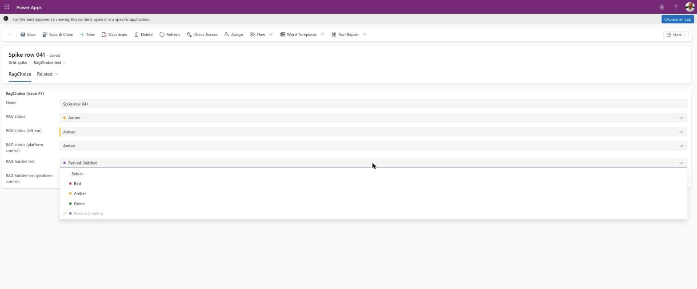
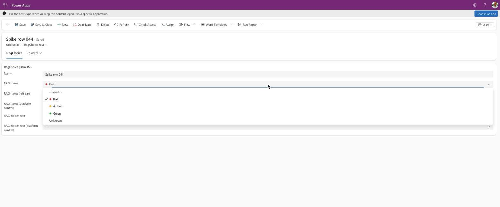
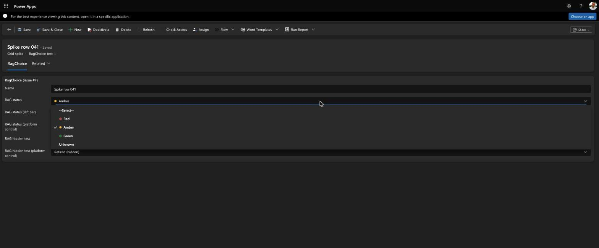
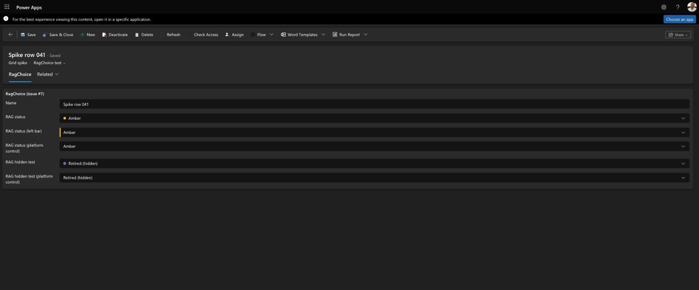
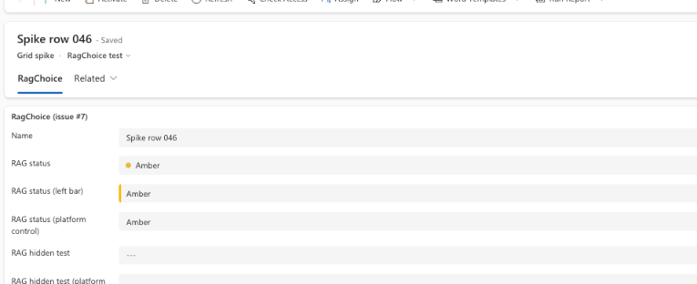
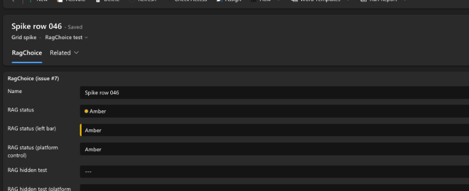

# RagChoice: dev verification (issue #7)

Results of the brief's VERIFY items for RagChoice (`docs/briefs/2026-10-21-grid-formatting-and-rag-choice.md` §6.3, §6.4) and the form rows of the §8.3 test matrix.

- **Environment:** `LowCode` (https://lowcode.crm.dynamics.com/), a personal test tenant, **not** the William Buck tenant. Set up as in [the test environment guide](../../../docs/testing/gridformatter-test-environment.md).
- **Build:** `WBRagChoice` imported unmanaged. Tested on 0.1.0, fixed in 0.1.1 and 0.1.2 (below), and the final checks re-run on 0.1.2.
- **Form:** a separate main form **"RagChoice test"** on `wb_gridspike`, created by [`scripts/test-env/add-ragchoice-form.mjs`](../../../scripts/test-env/add-ragchoice-form.mjs). It shows `wb_ragstatus` three times (RagChoice with a dot, RagChoice with the left bar, and the platform's own dropdown for comparison), plus a test column `wb_raghiddentest` with a hidden option, with RagChoice and with the platform dropdown.
- **Data:** `wb_ragstatus` options Red `#D13438`, Amber `#FFB900`, Green `#107C10`, and Unknown with no colour. `wb_raghiddentest` options Red, Amber, Green, and **Retired (hidden)** `#8764B8` with **Hidden** set.
- **Checked:** 22 Oct 2026, desktop Edge (Claude in Chrome), modern look, light and dark mode. Saved values were read back through the Web API.

## Summary

| Item | Result | Decision or fix |
|---|---|---|
| Solution import | ❌ on 0.1.0: the manifest's `description-key` had an apostrophe, which the import's XSD rejects (`noAposStringType`) | Reworded. `npm run check:controls` now fails on an apostrophe in any manifest `*-key` attribute |
| Each option selected → dot colour and saved value | ✅ Red, Amber, Green: dot and bar match the option colour; the Web API returns the selected value. Keyboard selection works too | — |
| Option without a colour (Unknown) | ✅ No dot or bar; saves `948790003` | — |
| Clearing (blank option) | ✅ `--Select--`, saves `null` | — |
| Value set by `formContext.getAttribute(...).setValue` | ✅ Dot, bar and label update; no `OnChange` fires, so the control doesn't echo the change back | — |
| User selection → `OnChange` | ✅ Fires once per selection | — |
| Lock (`setDisabled(true)`) and inactive record | ✅ Read-only with the dot or bar still shown. ⚠️ On 0.1.0 it was a disabled dropdown: greyed text and not focusable, unlike the platform's read-only field | **Fixed in 0.1.1:** read-only renders a read-only text box like the platform's (focusable, normal text colour, `---` when empty) |
| Business rule lock | ⚠️ Not tested with a real business rule | Business rules lock a field through the same `isControlDisabled` path as `setDisabled`, which passed. Left for a human to confirm |
| Field security, no read → `***`, no dot | ⏳ Not testable here | The tester is a System Administrator, who always has field access. Needs a user without read access (see "Left for a human") |
| Hidden options (VERIFY) | ❌ on 0.1.0: the hidden option was listed. **The platform does send it:** each option in `attributes.Options` has an undocumented `IsHidden` | **Fixed in 0.1.1:** hidden options are left out. A hidden option that is the current value stays in the list, disabled and ticked, exactly as the platform's dropdown does |
| Accessible name (VERIFY) | ❌ on 0.1.0: the form doesn't associate its label with the control (no `for`/`aria-labelledby`), and the control used the column display name, so a field labelled differently on the form announced the wrong name | **Fixed in 0.1.1:** `aria-label` is the form label (`context.mode.label`), falling back to the column display name. The accessibility tree now shows the same names as the platform's controls |
| Look and height | ⚠️ on 0.1.0: an outline (white, bordered) dropdown among the form's grey "filled" fields | **Fixed in 0.1.1:** `appearance="filled-darker"`. Background, border and height (32.5px) now match the platform's choice and text fields |
| Light and dark mode | ✅ The platform theme reaches the control: dark fill `#141414`, white text, dark list popup. The dot's neutral border is `#666666` in dark mode, and every RAG colour stays visible | — |
| Mobile app (phone) | ⏳ Not tested | Left for a human |
| Screen reader | ⏳ Not tested | The accessibility tree was checked (above). Left for a human with Narrator or VoiceOver |

## Hidden options

- **What PCF gets:** the form host passes each option as `{ Color, Label, Value, TransitionData, IsHidden }`. `IsHidden` isn't in the PCF typings (`@types/powerapps-component-framework` 1.3.18 has `Label`, `Value`, `Color`) or on Microsoft Learn's [OptionDescriptor](https://learn.microsoft.com/power-apps/developer/component-framework/reference/optiondescriptor) page. It was read from the control host's props in the browser.
- **What the platform does:** the platform dropdown leaves the hidden option out of the list. If the stored value **is** the hidden option, it shows it as the value and lists it greyed out and ticked, so it can't be picked again. Hidden options can still be set by `setValue` and the Web API (Microsoft Learn: [Choice hidden property limitations](https://learn.microsoft.com/power-apps/maker/data-platform/custom-picklists#choice-hidden-property-limitations)).
- **Client API:** `getAttribute(...).getOptions()` and `getControl(...).getOptions()` both include the hidden option, so they can't tell it apart.
- **Decision:** RagChoice treats `IsHidden === true` as hidden and copies the platform's behaviour. Because the property is undocumented, anything other than `true` means "not hidden". If the platform stops sending it, hidden options simply show again, which was the 0.1.0 behaviour.
- **Setting Hidden through the Web API:** use the `UpdateOptionValue` action with `IsHidden: true`. The `attributepicklistvalue` table that Microsoft Learn lists can't be queried (`RetrieveMultiple` isn't supported).

## Accessible name

- The form renders its field label as a `<label>` with no `for`, and puts no `aria-labelledby` on the control. A custom control isn't named by the form label automatically.
- The platform's own controls set `aria-label` to the **form** label (for example "RAG status (platform control)"), not the column display name.
- `context.mode.label` holds the form label (Microsoft Learn: "The defined control label"). The host's descriptor had `Label: "RAG status (left bar)"` for the field labelled that way on the form.
- After the fix, the accessibility tree shows `combobox "RAG status (left bar)"` (editable) and `textbox "RAG status (left bar)"` (read-only), the same names and roles as the platform's dropdown and read-only field.
- **Not checked:** what a screen reader actually announces.

## Other findings

- **The platform applies the control's output a moment later, not straight away.** Straight after a selection, `getAttribute(...).getValue()` still returned the old value. Three seconds later it had the new one, while the dropdown still had focus. So a script that calls `setValue(<the old value>)` within that moment is overridden by the user's selection, because the control keeps a selection that the platform hasn't confirmed yet (`syncSelection`). It's an edge case, and only for a script that sets the field back to its previous value. A `setValue` to any other value wins.
- **Empty text:** the platform's dropdown shows `---` when empty and `--Select--` on hover, focus and as the blank list option. RagChoice shows `--Select--` when editable and `---` when read-only.
- **Option colours in dark mode:** the colours come from metadata and don't adapt (brief §3.4). On the dark fill, Red `#D13438` is the least prominent, but every dot is visible thanks to its border.

## Screenshots

| | Light | Dark |
|---|---|---|
| Editable, list open |  |  |
| Closed (dot, bar, platform control, hidden value) | — |  |
| Read-only (inactive record) |  |  |

The dark read-only screenshot is from 0.1.1, before 0.1.2 widened the gap after the dot. The others are from 0.1.1 or 0.1.2; the editable view didn't change between them.

## Left for a human

- **Field security with no read:** create a column security profile without read on a secured copy of the column, and open the form as a user who isn't a System Administrator. Expected: `***`, no dot.
- **Field security with read but no update:** expected read-only with the dot.
- **A real business rule** that locks the field. Expected: read-only with the dot.
- **Screen reader** (Narrator or VoiceOver): the field announces the form label, its value, and "combo box" (editable) or "read only" (locked).
- **Mobile app (phone):** the control loads, the list is usable by touch, and the value saves. The form XML sets RagChoice for form factors 0, 1 and 2.
